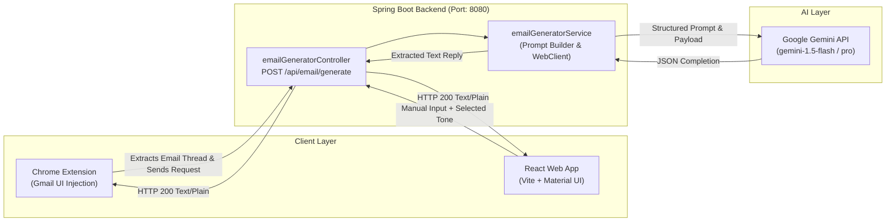

# 📧 Smart Email Assistant

[](https://www.oracle.com/java/)
[](https://spring.io/projects/spring-boot)
[](https://react.dev/)
[](https://vitejs.dev/)
[](https://mui.com/)
[](https://ai.google.dev/)
[](https://developer.chrome.com/docs/extensions/)
[](LICENSE)

> An end-to-end, AI-powered intelligent email reply generator designed to streamline email communication. Built with a high-performance **Spring Boot** reactive backend, a modern **React + Material UI** web interface, and a **Chrome Extension (Manifest V3)** that integrates directly into the **Gmail** compose window.

---

## 📑 Table of Contents

- [Overview](#-overview)
- [Key Features](#-key-features)
- [Architecture & Workflow](#-architecture--workflow)
- [Project Structure](#-project-structure)
- [Tech Stack](#-tech-stack)
- [Prerequisites](#-prerequisites)
- [Installation & Setup](#-installation--setup)
  - [1. Backend Setup (Spring Boot)](#1-backend-setup-spring-boot)
  - [2. Frontend Setup (React + Vite)](#2-frontend-setup-react--vite)
  - [3. Chrome Extension Setup (Gmail Integration)](#3-chrome-extension-setup-gmail-integration)
- [API Reference](#-api-reference)
- [How It Works](#-how-it-works)
- [Roadmap & Future Enhancements](#-roadmap--future-enhancements)
- [Contributing](#-contributing)
- [Author](#-author)

---

## 🌟 Overview

Drafting thoughtful, context-aware, and professionally toned emails can consume significant time. **Smart Email Assistant** automates this workflow by analyzing incoming email context and generating structured, personalized replies in seconds using Google's **Gemini AI**.

Whether you want to use the dedicated **Web Dashboard** to generate and copy responses or prefer **1-Click Generation directly inside Gmail**, this solution provides seamless accessibility across workflows.

---

## ✨ Key Features

- **🧠 Google Gemini AI Integration**: Utilizes Google's Gemini models via WebClient for fast, high-quality, and contextually accurate response generation.
- **🎯 Tone Customization**: Choose the desired tone to match your context:
  - *Professional* (Default)
  - *Casual*
  - *Friendly*
  - *Custom/Neutral*
- **🧩 Gmail Chrome Extension (Manifest V3)**:
  - Dynamically injects an **"AI Reply"** button into the Gmail compose toolbar using DOM `MutationObserver`.
  - Automatically extracts conversation context from the current thread.
  - Automatically inserts the generated reply directly into the active compose text box.
- **💻 Responsive Web Application**:
  - Clean, accessible UI powered by **React 19** and **Material UI (MUI)**.
  - Instant one-click **"Copy to Clipboard"** functionality.
  - Real-time loading indicators and robust error handling.
- **⚡ Reactive & Decoupled Architecture**: Spring Boot backend handles LLM interaction securely, keeping API keys protected on the server side with non-blocking WebClient I/O.

---

## 🏛 Architecture & Workflow



---

## 📂 Project Structure

```text
Smart-Email-Assistant/
├── email-writer-sb/             # Spring Boot Backend Service
│   ├── mvnw / mvnw.cmd          # Maven Wrapper scripts
│   ├── pom.xml                  # Maven dependencies & build config
│   └── src/
│       ├── main/
│       │   ├── java/com/email/writer/
│       │   │   ├── Controller/
│       │   │   │   └── emailGeneratorController.java  # REST API controller
│       │   │   ├── DTO/
│       │   │   │   └── emailRequest.java              # Request Payload DTO
│       │   │   ├── Service/
│       │   │   │   └── emailGeneratorService.java     # Gemini API integration
│       │   │   └── EmailWriterApplication.java        # Main Spring Boot application
│       │   └── resources/
│       │       └── application.properties             # Environment configuration
│       └── test/                                      # Unit & integration tests
│
├── email-writer-react/          # React Web Application
│   ├── index.html               # Entry HTML
│   ├── package.json             # NPM dependencies & scripts
│   ├── vite.config.js           # Vite build configuration
│   └── src/
│       ├── App.jsx              # Main React dashboard & state management
│       ├── App.css              # Custom styling
│       ├── main.jsx             # React DOM root entry
│       └── index.css            # Global CSS
│
└── email-writer-ext/            # Chrome Extension (Manifest V3)
    ├── manifest.json            # Extension metadata, permissions & content script definitions
    ├── content.js               # Gmail DOM observer, UI injector & API caller
    ├── content.css              # Custom styling for injected UI elements
    └── popup.js / hello.html    # Extension popup assets
```

---

## 🛠 Tech Stack

| Component | Technologies Used |
| :--- | :--- |
| **Backend** | Java 21, Spring Boot, Spring WebMvc, Spring WebFlux (`WebClient`), Project Lombok, Jackson |
| **Frontend** | React 19, Vite, Material UI (MUI), Emotion (`@emotion/react`, `@emotion/styled`), Axios |
| **Browser Extension** | JavaScript (ES6+), Chrome Extensions API (Manifest V3), MutationObserver, CSS3 |
| **AI / LLM** | Google Gemini API |
| **Tools & Build** | Maven, npm, Git |

---

## 📋 Prerequisites

Before getting started, ensure you have the following installed on your system:

- **Java Development Kit (JDK)**: Version 21 or higher
- **Node.js**: Version 18.x or higher & **npm**
- **Maven**: Version 3.8+ (or use the included `./mvnw` wrapper)
- **Google Gemini API Key**: Obtain a free API key from [Google AI Studio](https://aistudio.google.com/)
- **Google Chrome** browser (for loading the extension)

---

## 🚀 Installation & Setup

### 1. Clone the Repository

```bash
git clone https://github.com/Dev-Ashish-Mishra/Smart-Email-Assistant.git
cd Smart-Email-Assistant
```

---

### 1. Backend Setup (Spring Boot)

1. Navigate to the backend directory:
   ```bash
   cd email-writer-sb
   ```

2. Set your **Gemini API** credentials. You can set them as environment variables or update `src/main/resources/application.properties`:

   **Option A: Export Environment Variables (Recommended)**
   ```bash
   export Gemini_Url="https://generativelanguage.googleapis.com/v1beta/models/gemini-1.5-flash:generateContent?key="
   export Gemini_Key="YOUR_GEMINI_API_KEY_HERE"
   ```

   **Option B: Edit `application.properties` directly**
   ```properties
   spring.application.name=email-writer
   gemini.api.url=https://generativelanguage.googleapis.com/v1beta/models/gemini-1.5-flash:generateContent?key=
   gemini.api.key=YOUR_GEMINI_API_KEY_HERE
   ```

3. Build and run the Spring Boot service:
   ```bash
   # Using Maven Wrapper (macOS / Linux)
   ./mvnw clean spring-boot:run

   # Windows
   mvnw.cmd clean spring-boot:run
   ```

   The backend will start and listen on port **`8080`** (`http://localhost:8080`).

---

### 2. Frontend Setup (React + Vite)

1. Open a new terminal window and navigate to the frontend directory:
   ```bash
   cd email-writer-react
   ```

2. Install dependencies:
   ```bash
   npm install
   ```

3. Launch the development server:
   ```bash
   npm run dev
   ```

4. Open your browser and navigate to **`http://localhost:5173`** (or the port specified in terminal).

---

### 3. Chrome Extension Setup (Gmail Integration)

1. Open Google Chrome and go to `chrome://extensions/`.
2. Toggle on **"Developer mode"** in the top-right corner.
3. Click on the **"Load unpacked"** button.
4. Select the **`email-writer-ext`** folder from this project directory (`Smart-Email-Assistant/email-writer-ext`).
5. Open [Gmail](https://mail.google.com/) in your browser.
6. Open any email thread and click **Reply**, or click **Compose**.
7. You will see a newly injected **"AI Reply"** button in the compose window toolbar! Click it to automatically generate and insert an AI reply into the editor.

> [!NOTE]
> Make sure the Spring Boot backend (`http://localhost:8080`) is running for the Chrome extension and React app to process requests.

---

## 📡 API Reference

### Generate Email Reply

Processes email content and returns an AI-crafted response according to the specified tone.

- **Endpoint**: `/api/email/generate`
- **Method**: `POST`
- **Content-Type**: `application/json`
- **CORS**: Enabled (`*`)

#### Request Body
```json
{
  "emailContent": "Hi Ashish, Could you please provide an update on the project delivery timeline? Thanks, Manager.",
  "tone": "professional"
}
```

| Field | Type | Required | Allowed Values / Description |
| :--- | :--- | :--- | :--- |
| `emailContent` | `string` | **Yes** | The original incoming email text or conversation context. |
| `tone` | `string` | No | `professional`, `casual`, `friendly`, or empty/omitted for default tone. |

#### Sample Response (`200 OK`)
```text
Dear Manager,

Thank you for reaching out. The project is currently progressing on schedule, and we are on track to meet our key milestones for the upcoming release. I will share a detailed status report by tomorrow afternoon.

Best regards,
Ashish
```

---

## 💡 How It Works

1. **Prompt Engineering**: The backend parses incoming email context and automatically crafts a prompt instructing Gemini to produce a clean reply without redundant subject lines, tailored strictly to the desired tone.
2. **DOM Detection via MutationObserver**: The Chrome extension monitors Gmail's reactive DOM changes. Whenever a compose dialog (`.btC`, `.aDh`, `[role="dialog"]`) opens, it dynamically mounts the AI button.
3. **Seamless Direct Injection**: When clicked, the extension queries the email body from the active thread, requests a completion from the backend, and uses `document.execCommand('insertText')` to paste the reply right into Gmail's content-editable element while respecting cursor focus.

---

## 🗺 Roadmap & Future Enhancements

- [ ] Support customizable multi-tone selection in the Chrome Extension popup.
- [ ] Add support for multiple LLM providers (e.g. OpenAI GPT-4o, Anthropic Claude, Ollama local models).
- [ ] Email summarization and bullet-point key takeaway extractor.
- [ ] Support for Outlook Web and other webmail clients.
- [ ] User authentication and saved custom prompt templates.

---

## 🤝 Contributing

Contributions are welcome and appreciated! If you'd like to contribute:

1. **Fork** the repository.
2. **Create a branch** for your feature or bug fix:
   ```bash
   git checkout -b feature/awesome-new-feature
   ```
3. **Commit** your changes:
   ```bash
   git commit -m "Add: support for multiple AI models"
   ```
4. **Push** to the branch:
   ```bash
   git push origin feature/awesome-new-feature
   ```
5. Open a **Pull Request**.

---

## 👨‍💻 Author

**Ashish Mishra**
- GitHub: [@Dev-Ashish-Mishra](https://github.com/Dev-Ashish-Mishra)
- Repository: [Smart-Email-Assistant](https://github.com/Dev-Ashish-Mishra/Smart-Email-Assistant)

---

## 📄 License

This project is open-source and available under the [MIT License](LICENSE).
